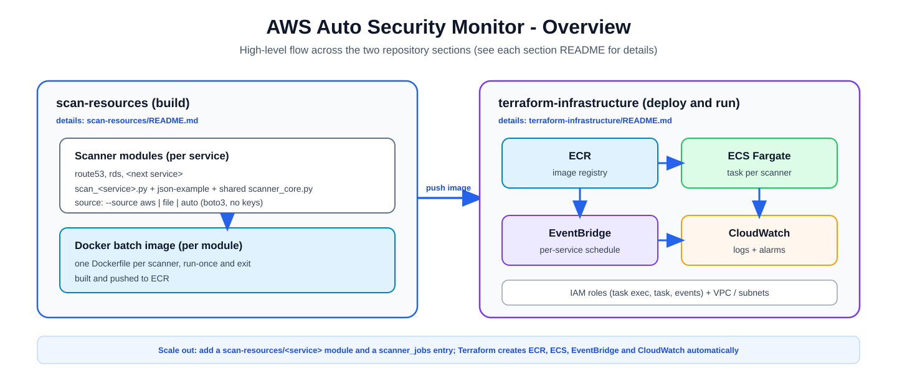

# 📘 AWS Auto Security Monitor
Scalable baseline to scan AWS resources with containerized Python jobs and recurring execution on AWS.

## 🗺️ Workflow
High-level overview of how the two sections connect. See each section README for the detailed diagrams.

## 🧱 Repository Structure
- `scan-resources`: scanner modules (one module per AWS service), local execution, and Docker batch images.
- `terraform-infrastructure`: AWS infrastructure with ECS, ECR, EventBridge, CloudWatch, and IAM.

## ▶️ Getting Started
Use the module-specific documentation to run commands and deploy:

- `scan-resources/README.md` for scanner execution, Docker usage, and module creation.
- `terraform-infrastructure/README.md` for Terraform provisioning and infrastructure operations.

> Prerequisite: Terraform state is stored on S3. Create the state bucket (versioning + encryption) and set its name in `terraform-infrastructure/backend.tf` before running `terraform init`. See the Remote State section in `terraform-infrastructure/README.md`.

## 📈 Scaling Model
This project is designed to grow by adding new scanner modules:

- Add a new module under `scan-resources/<service>/` with:
  - `scan_<service>.py`
  - `Dockerfile`
  - `json-example/example.json`
- Add the module entry in `terraform-infrastructure/terraform.tfvars` under `scanner_jobs`.
- Terraform will create the required ECR repository, ECS task definition, EventBridge schedule, CloudWatch logs, and alarm.

## 📚 Module Documentation
- Scanning framework and module authoring guide: `scan-resources/README.md`
- Infrastructure and deployment guide: `terraform-infrastructure/README.md`

## 📝 Notes
- Scanner scripts support `--source aws|file|auto`.
- AWS discovery uses `boto3` and IAM roles (no API keys).

REVISAR LA NOMENCLATURA DE TODOS LOS NOMBRES DE LOS SERVICIOS Y RECURSOS EN AWS