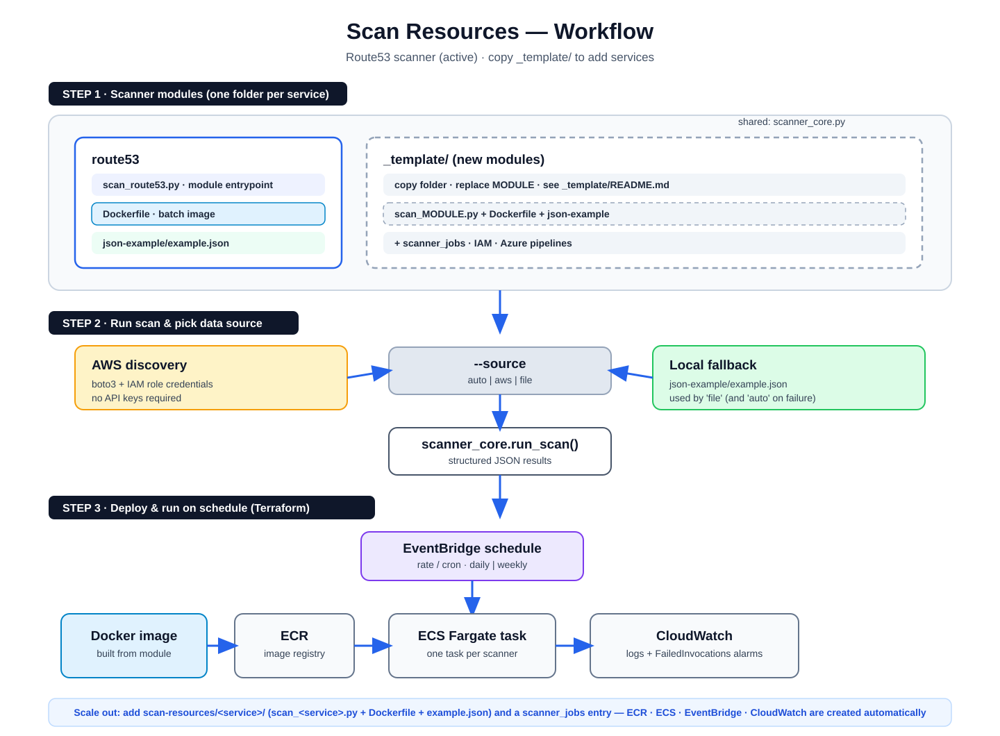

# 📘 Scan Resources
Python batch scanners for AWS. **Active module:** `route53`. New modules: [_template/README.md](_template/README.md).

## 🗺️ Workflow


## 🧱 Layout
```text
scan-resources/
  scanner_core.py       # check engine, load_resources, S3 persist
  requirements.txt
  _template/            # copy to add a module
  route53/
    Dockerfile
    scan_route53.py
    json-example/example.json
```

## ▶️ Route53 — local run
```bash
python scan-resources/route53/scan_route53.py --source auto
```

| Flag | Description |
|------|-------------|
| `--source auto\|aws\|file` | `aws`: boto3; `file`: `json-example/example.json`; `auto`: aws then fallback |
| `--resources-file <path>` | Custom JSON input |
| `--domain-timeout <sec>` | Per-domain AWS discovery timeout (default: 30, env: `ROUTE53_DOMAIN_TIMEOUT_SECONDS`) |
| `--max-domains <n>` | Max hosted zones per run (default: 10) |

### Batch behaviour
- Scans **one domain at a time** with logging to stderr.
- **Pushes each zone** to S3 as it completes (`…/runs/{batch_id}/zones/{zone_id}.json`) and updates a running `summary.json` (no data loss if the task dies mid-run).
- **Exit code 1** if any domain has `fail` or `error` (ECS task fails → SNS notification).
- **Timeout** → checks `fail` with `domain discovery timed out after Ns` (not `error`). API discovery errors → `error`.

## 🐳 Route53 — Docker
Build context = repo root. CI: [azure-pipelines/scanners-build.yml](../azure-pipelines/scanners-build.yml).

```bash
docker build -f scan-resources/route53/Dockerfile -t scanners:route53 .
docker run --rm scanners:route53
```

## ⚙️ Scanner framework (`scanner_core.py`)

### 🧾 `example.json`
```json
{
  "resources": [
    {
      "id": "resource-id",
      "type": "resource-type",
      "checks": ["check_1"],
      "check_1": true
    }
  ]
}
```

### 🛡️ Check engine
- Each module defines `CHECKS`: `check_name -> Check(severity, fn)`.
- `run_scan()` evaluates checks → `pass` / `fail` / `error` + severity summary.
- Reference implementation: `route53/scan_route53.py`.

### 📦 Findings (S3)
Scripts set `FINDINGS_S3_BUCKET` and `FINDINGS_S3_PREFIX` at the top (overridden by ECS env vars). Empty bucket locally skips upload. See [terraform-infrastructure/README.md](../terraform-infrastructure/README.md) for the bucket and IAM side.

## ➕ New module
Do not duplicate steps here — follow [_template/README.md](_template/README.md).
