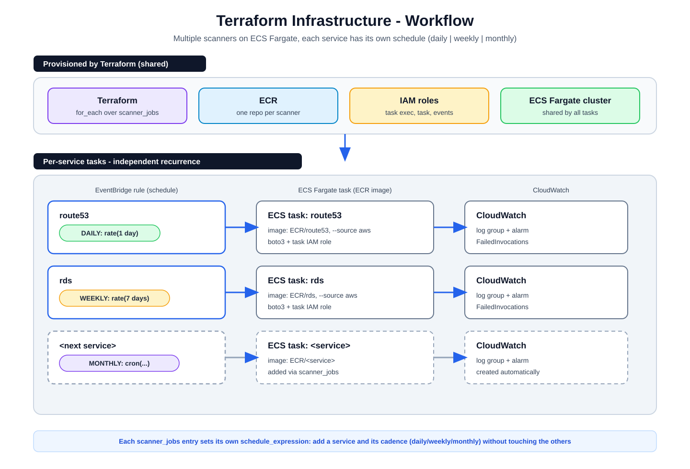

# 📘 Terraform Infrastructure
ECS Fargate scanner platform on AWS. Scales via `scanner_jobs` in [environments/](environments/README.md).

## 🗺️ Workflow


## 📂 File layout
```text
terraform-infrastructure/
  versions.tf, providers.tf, backend.tf, variables.tf, outputs.tf, locals.tf
  network.tf, ecr.tf, ecs.tf, eventbridge.tf, cloudwatch.tf, s3.tf, sns.tf, iam.tf
  environments/     # tfvars + backend per env
```

## 🏗️ Architecture

### 🌐 Shared (one per environment)
| File | Resources |
|------|-----------|
| `ecr.tf` | ECR `{project}/scanners`, lifecycle policy, tag per module |
| `ecs.tf` | Fargate cluster, task definitions (`for_each`) |
| `s3.tf` | Findings bucket (versioning, encryption) |
| `sns.tf` | Alarm topic, email subs, EventBridge notify rules |
| `iam.tf` | Task execution, task, EventBridge invoke roles |
| `network.tf` | VPC, subnets, security group |
| `backend.tf` | Partial S3 backend — config in `environments/*.backend.hcl` |

### 🔁 Per `scanner_jobs` key (auto-created)
Task definition, EventBridge schedule, CloudWatch log group, `FailedInvocations` alarm, SNS task-completed rule.

**Default:** `route53` only. Add keys to grow; Python code lives in `scan-resources/` ([_template](../scan-resources/_template/README.md)).

### ⏱️ Triggers
| Mode | Mechanism |
|------|-----------|
| Scheduled | EventBridge `schedule_expression`; `enabled` in `scanner_jobs` |
| On-demand | `scripts/run-scanner.sh`, Azure `scanners-ops`, or `aws ecs run-task` |

### 🔔 SNS (`alarm_notification_emails` required)
| Event | Mechanism |
|-------|-----------|
| Task finished | EventBridge per-scanner (`EssentialContainerExited`, exit code) |
| Task failed to start | EventBridge cluster rule |
| Invoke failed | CloudWatch `FailedInvocations` → SNS |

### 📦 Findings
Terraform injects `FINDINGS_S3_BUCKET` / `FINDINGS_S3_PREFIX` into tasks. Upload logic: [scan-resources/README.md](../scan-resources/README.md).

## 🏷️ Naming
Prefix: `tf-{environment}-{project_name}-…`

| Resource | Example |
|----------|---------|
| Cluster | `tf-qa-security-scan-cluster` |
| Task / rule | `tf-qa-security-scan-route53` / `…-route53-schedule` |
| SNS | `tf-qa-security-scan-alarms` |
| ECR | `security-scan/scanners` |
| Findings S3 | `tf-qa-security-scan-findings` |

## 📐 Variables and outputs
Full validation: `variables.tf`. Key outputs: `name_prefix`, `ecs_cluster_name`, `task_definition_families`, `eventbridge_rule_names`, `ecr_repository_url`, `findings_s3_bucket`.

## 🚀 Deploy
Commands and state layout: [environments/README.md](environments/README.md).

First apply creates infra; then run **scanners-build** ([azure-pipelines/scanners-build.yml](../azure-pipelines/scanners-build.yml)).

## 📈 Terraform-only scaling
1. Add `scanner_jobs` entry in `environments/<env>.tfvars`
2. Add IAM in `iam.tf` for new AWS APIs
3. `terraform plan -out=tfplan && terraform apply tfplan`

Python, Docker, and pipelines: [_template/README.md](../scan-resources/_template/README.md).

## 🔄 CI/CD
Infrastructure pipeline: [azure-pipelines/infrastructure.yml](../azure-pipelines/infrastructure.yml). Variable group: [variable-group.example.md](../azure-pipelines/variable-group.example.md).

## 🔒 Security
- Secrets in gitignored `environments/*.tfvars`, not in `.tf`
- ECS tasks use IAM roles (no API keys)
- Findings bucket blocks public access
